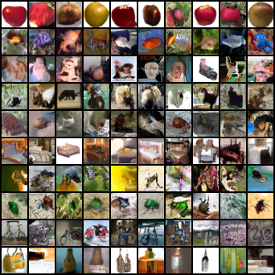

# CIFAR-100 实测结果归档

原实验：`cifar100-scalar-fm-500k-20260917`。名字中的 500K 是原定目标，
**实际训练至 450K；450K 评估未完成，完整可报告结果到 400K。**
所有数字来自已完成的历史 `metrics.json`，本次发布没有重新训练。

同一协议：EMA、Heun60（120 次速度预测）、batch64、seed20260912；
50,000 张生成图片（每类500张），完整10,000张无增强测试图片反向ODE分类。
FID 主列参考全部50,000张原始训练图片；特征为 torch-fidelity Inception2048。

| 训练 step | 反向 ODE 分类准确率 | FID train50K ↓ | IS ↑ |
|---|---:|---:|---:|
| 50K | 10.26% | 31.75 | 6.82 |
| 100K | 24.69% | 18.91 | 8.29 |
| 150K | 33.45% | 15.69 | 8.74 |
| 200K | 38.74% | 14.00 | 9.02 |
| 250K | 42.62% | 12.89 | 9.22 |
| 300K | 44.63% | 12.25 | 9.35 |
| 350K | 46.38% | 11.63 | 9.50 |
| 400K | **47.22%** | **11.14** | **9.61** |

注意：这些是 **CIFAR-100** 结果，不是 CIFAR-10 的约90%准确率。
没有配置独立 CIFAR-100 图像评分分类器，因此**生成类别准确率未测量**。
也没有 KID 结果。反向分类准确率不能当作生成类别准确率，IS 也不是类别准确率。

机器可读：[summary.csv](summary.csv)。各 `STEP.json` 包含原始数值、混淆矩阵、
逐类准确率、类别名、DCT模式、评估协议和原 checkpoint SHA256，已去掉机器绝对路径。
[original-450k-config.json](original-450k-config.json) 是原运行配置归档；其中 CE/OT 参数
是历史通用 parser 的未启用默认值，不代表使用这些损失。可执行复现入口只允许纯 FM。

## 400K 生成示例

以下来自正式50K评估的前10类，每行同一请求类别，每类10张；不是筛选正确图片。
行类别依次为 apple、aquarium_fish、baby、bear、beaver、bed、bee、beetle、bicycle、bottle。

重新运行评估会输出全部100类的10页网格，以及总网格。仓库仅归档一页代表图，
不包含权重、数据集或 `.npz` 特征/图片缓存。
