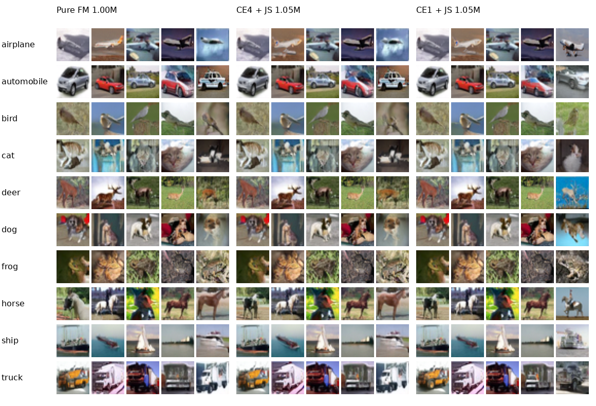

# CIFAR-10：CE1 训练、Euler1 分类推理

同一个无标签输入的速度网络，同时完成正向生成和反向分类。先训练纯 Gaussian
flow matching（FM）1,000,000 步，再追加一步反向 CE 与双独立 pad4 视角 JS。
**CE1 表示反向分类监督使用 Euler1；生成仍采用 Heun60，不是一步生成模型。**

## 已完成结果

EMA 权重，CIFAR-10 原始完整 test10K，FP32、TF32 关闭；无测试增强。
“追加步数”均相对公共纯 FM 1M 起点。

| 追加训练 | CE1训练 → Euler1推理 | CE1训练 → Euler4推理 |
|---|---:|---:|
| 0（纯FM起点） | 89.88% | 89.72% |
| 10K | 90.85% | 90.77% |
| 20K | 91.82% | 91.48% |
| 30K | 92.23% | 91.82% |
| 40K | 92.45% | 91.96% |
| 50K | **92.72%** | **91.99%** |

+50K 的 Heun60 生成50K结果：**FID=4.8161**（原始 train50K 参考）、生成类别准确率
**90.438%**、Heun60 反向分类 **91.61%**。原始指标保存在 [results](results/)。
历史 CE4训练→Euler4推理在相同 +50K 为92.37%，本轮CE1高0.35个百分点；这不是多随机种子结论。
500K续训仍在进行；本发布仅包含已完成的+50K，不将计划中的结果写作已完成。



## 环境与数据

以下命令在**仓库根目录**运行。原实验环境为Python 3.8.10、PyTorch 2.0.0+cu118、
torchvision 0.15.1+cu118，单张RTX4090 D（24GB）。训练和正式评估需要CUDA。
U-Net源代码随包提供，无需安装TorchCFM；来源与MIT许可证见 [vendor_unet](vendor_unet/PROVENANCE.md)。

```bash
git clone --branch experiment/cifar10-ce1 https://github.com/babahui/reversible-ode-generation-classification.git
cd reversible-ode-generation-classification
python3.8 -m venv .venv-ce1
source .venv-ce1/bin/activate
python -m pip install torch==2.0.0 torchvision==0.15.1 --index-url https://download.pytorch.org/whl/cu118
python -m pip install -r cifar10_ce1/requirements.txt
python -m cifar10_ce1.prepare_data --data-root ./data
```

已有数据时，`--data-root` 指向包含 `cifar-10-batches-py/` 的父目录。数据由torchvision
下载并校验；训练本身不自动下载。输入为RGB 32×32，归一化 `uint8 / 127.5 - 1`。

## 预训练权重

下载页面：[GitHub Release: cifar10-ce1-50k-v1](https://github.com/babahui/reversible-ode-generation-classification/releases/tag/cifar10-ce1-50k-v1)。

| 文件 | 用途 | 下载 |
|---|---|---|
| `cifar10-ce1-1050000-ema.pt` | +50K EMA，直接分类和生成，约143MB | [EMA权重](https://github.com/babahui/reversible-ode-generation-classification/releases/download/cifar10-ce1-50k-v1/cifar10-ce1-1050000-ema.pt) |
| `cifar10-ce1-1050000-full.pt` | +50K完整状态，继续训练，约572MB | [续训权重](https://github.com/babahui/reversible-ode-generation-classification/releases/download/cifar10-ce1-50k-v1/cifar10-ce1-1050000-full.pt) |
| `cifar10-fm-1000000-full.pt` | 公共纯FM 1M完整初始化，约572MB | [FM初始化](https://github.com/babahui/reversible-ode-generation-classification/releases/download/cifar10-ce1-50k-v1/cifar10-fm-1000000-full.pt) |
| `cifar10-reference-classifier.pt` | 独立生成类别评分器；分类/生成推理不需要它 | [评分器](https://github.com/babahui/reversible-ode-generation-classification/releases/download/cifar10-ce1-50k-v1/cifar10-reference-classifier.pt) |

[weights.json](weights.json) 记录文件大小、用途和SHA256。可自动下载并校验：

```bash
# 只下载EMA推理权重
python -m cifar10_ce1.download_weights --output ./weights
# 训练/完整指标需要全部文件
python -m cifar10_ce1.download_weights --output ./weights --all
```

本包与仓库旧的`model-1000000.pt`（不同网络/实验）不能混用。EMA-only文件不含Adam，
不能用于完整断点续训。发布文件保持原始字节；其中的历史绝对路径仅为来源元数据，
运行时使用CLI提供的路径。恢复训练允许数据与源文件路径迁移，同时校验源文件SHA256。

## 直接推理

### 完整测试集一步分类（复现92.72%）

```bash
CUDA_VISIBLE_DEVICES=0 python -m cifar10_ce1.evaluate_reverse_test \
  --checkpoint ./weights/cifar10-ce1-1050000-ema.pt \
  --data-root ./data --output ./outputs/ce1-euler1-test \
  --method euler --steps 1
```

输出`metrics.json`、混淆矩阵、逐样本`predictions.npz`和带checkpoint SHA256的协议。
改成`--steps 4`并使用新输出目录，即CE1训练→Euler4推理（91.99%），不是CE4训练模型。
增加`--split train`可评估原始train50K。

### 自己的图片与生成网格

```bash
python -m cifar10_ce1.infer classify \
  --checkpoint ./weights/cifar10-ce1-1050000-ema.pt \
  --images ./my-image.png --output ./outputs/my-classification

CUDA_VISIBLE_DEVICES=0 python -m cifar10_ce1.infer sample \
  --checkpoint ./weights/cifar10-ce1-1050000-ema.pt \
  --output ./outputs/ce1-grid --per-class 5 --method heun --steps 60
```

类别顺序：airplane、automobile、bird、cat、deer、dog、frog、horse、ship、truck。
本地图片转RGB并双线性缩放至32×32；任意域外图片不保证与CIFAR-10表现一致。
`infer`支持`--device cpu`。生成输出`grid.png`和`samples.npz`；每行一个类别。
网格采用独立随机流，不应与正式评估按batch偏移采样的图片逐像素比较。

### FID、生成类别准确率和Heun60反向分类

```bash
CUDA_VISIBLE_DEVICES=0 python -m cifar10_ce1.evaluate \
  --checkpoint ./weights/cifar10-ce1-1050000-ema.pt \
  --data-root ./data --output ./outputs/ce1-50k-full \
  --cache ./runs/cifar10-reference-cache \
  --classifier ./weights/cifar10-reference-classifier.pt \
  --samples 50000 --batch-size 64 --method heun --steps 60 \
  --seed 20260912 --reverse-images 10000
```

首次运行会下载torch-fidelity Inception并构建参考特征缓存，耗时额外增加。
主FID为生成50K vs原始train50K；另存的test5K和legacy指标口径不同，不能混比。
独立评分器只评估生成类别，不引导模型、不参与反向分类。未提供评分器时单独评估入口
仍可算FID，但不会产出生成类别准确率；自动完整评估队列要求评分器存在。
批大小固定64，随机种子为`20260912 + batch_offset`；改变batch会改变生成样本。
ODE内部不裁剪；最终转uint8为`(x*127.5+128).clamp(0,255).uint8`。

## 训练

### A. 从头训练公共纯FM 1M（也可直接下载上面的完整FM权重）

```bash
CUDA_VISIBLE_DEVICES=0 python -m cifar10_ce1.train \
  --kind gaussian --data-root ./data --output ./runs/cifar10-fm-1m \
  --steps 1000000 --batch-size 128 --sigma 0.5 --center-scale 12 \
  --lr 0.0002 --warmup 5000 --ema-decay 0.9999 --amp none --seed 0 \
  --save-every 25000 --snapshot-every 25000 --preview-every 25000 \
  --keep-previous-checkpoint --resume
```

完成后的`runs/cifar10-fm-1m/training-latest.pt`是完整1M状态，可替代后续命令的`--source`。
若继续训练纯FM，先复制这份1M完整文件留作CE1起点；滚动latest会被后续更新替换。

### B. 从公共FM 1M追加CE1 50K，每10K分类、终点完整评估

```bash
CUDA_VISIBLE_DEVICES=0 python -m cifar10_ce1.run_study \
  --source ./weights/cifar10-fm-1000000-full.pt \
  --data-root ./data --output ./runs/cifar10-ce1-50k \
  --added-steps 50000 --eval-every 10000 --full-eval-every 50000 \
  --classifier ./weights/cifar10-reference-classifier.pt
```

训练和评估在一张卡上顺序执行，评估后自动继续。原始0步基线可用
`evaluate_reverse_test --checkpoint ./weights/cifar10-fm-1000000-full.pt`分别配合Euler1/Euler4评估。
日志在`logs/`，当前状态在`status.json`，训练速度在`training/progress.json`。

### C. 从已发布的CE1 +50K继续到累计+500K，每100K评估

```bash
CUDA_VISIBLE_DEVICES=0 python -m cifar10_ce1.run_study \
  --source ./weights/cifar10-fm-1000000-full.pt \
  --resume-from ./weights/cifar10-ce1-1050000-full.pt \
  --data-root ./data --output ./runs/cifar10-ce1-500k \
  --added-steps 500000 --eval-every 100000 --full-eval-every 100000 \
  --classifier ./weights/cifar10-reference-classifier.pt
```

这表示从总1.05M继续至总1.50M，剩余450K；不重新训练50K、不重置Adam/EMA和CE/JS预热。
重新启动时执行同一命令，但**删除`--resume-from`及其值**，读取输出目录自己的最新状态。
也可直接用B的输出目录延长到500K，同样不传`--resume-from`。
从FM起点直接跑500K则省略`--resume-from`，使用一个新输出目录。
仅训练时加`--train-only`。每5K保存完整状态和前一份；每评估节点保留EMA与完整状态。
低于15GiB剩余磁盘时队列退出，不自动删除文件。

原机器实测速率约0.193秒/步；剩余450K纯训练约24.2小时，五次完整评估约4小时，
合计约28–30小时。首次构建FID缓存、其他硬件或GPU共享会增加耗时。

## 固定训练协议

| 项目 | 设置 |
|---|---|
| 网络 | vendored TorchCFM U-Net，35,746,307参数，base128，mult=[1,2,2,2] |
| 输入 | 标量t与图像；真实/预测标签均不输入U-Net |
| prior | 10个固定正交低频中心，范数12，类内Gaussian sigma=0.5，类别先验均匀 |
| FM | batch128，随机水平翻转；独立配对，线性路径，速度MSE |
| CE/JS视角 | 32张原图×两个独立反射pad4裁剪，共64视角；不改变FM输入 |
| 反向监督 | 每4次更新执行一次Euler1，完整t=1→0；关闭dropout，保持梯度 |
| CE | 固定中心投影scores，权重0.001，起点后2K预热 |
| JS | 两视角对称JS，温度2，乘T²；权重0.001，起点后5K预热 |
| 优化 | Adam，lr=min_lr=2e-4，clip norm=1，EMA=0.9999；FP32/TF32关闭 |
| 不启用 | OT、history、轨迹扰动、外部分类器引导 |

Euler1反向分类就是`z_hat = x - v_theta(1, x)`，再按固定Gaussian中心计算类别后验。
生成由指定类别选择Gaussian初始噪声，从t=0积分至1；标签不进入速度网络。
固定seed不保证跨PyTorch版本/硬件逐位一致。

源码与原实验快照对应关系见[source-manifest.json](source-manifest.json)；移植仅涉及包内导入、
默认路径、训练恢复时的路径迁移及新增入口。原训练计算、中心构造和U-Net保持一致。
验证记录见[VERIFICATION.md](VERIFICATION.md)。
