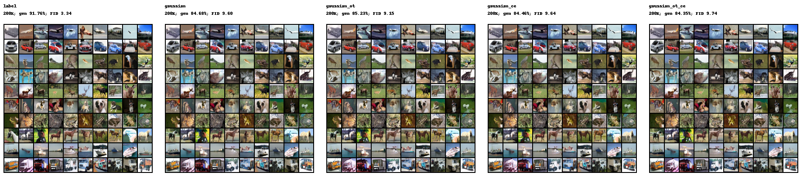
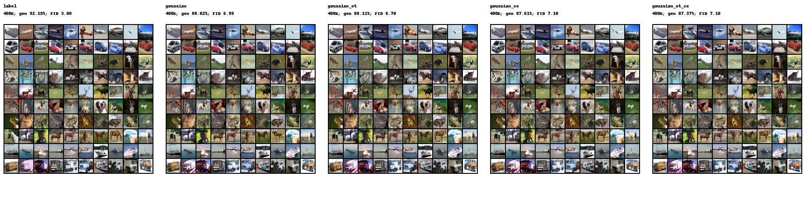
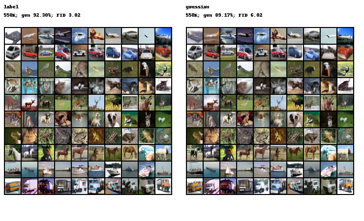

# CIFAR-10: New-backbone Results

Frozen export of completed evaluations, not live job status. No 1M result is available in this snapshot.

## Matched training budget: 400K

| Method | Step | Generated accuracy | Reverse accuracy | FID | IS |
|---|---:|---:|---:|---:|---:|
| Label-conditioned | 400K | 92.19% | N/A | 3.0032 | 9.611 |
| Low-frequency Gaussian-only | 400K | 88.02% | 87.86% | 6.9877 | 8.604 |
| Gaussian + OT | 400K | 88.11% | 87.94% | 6.7047 | 8.658 |
| Gaussian + reverse CE | 400K | 87.61% | 89.97% | 7.1029 | 8.543 |
| Gaussian + OT + reverse CE | 400K | 87.37% | 89.54% | 7.0989 | 8.591 |

## Latest completed checkpoint per method

**Different step counts: these rows are not a matched-budget ranking.**

| Method | Step | Generated accuracy | Reverse accuracy | FID | IS |
|---|---:|---:|---:|---:|---:|
| Label-conditioned | 550K | 92.30% | N/A | 3.0175 | 9.599 |
| Low-frequency Gaussian-only | 550K | 89.17% | 88.42% | 6.0211 | 8.749 |
| Gaussian + OT | 500K | 88.66% | 88.34% | 6.1301 | 8.772 |
| Gaussian + reverse CE | 450K | 87.77% | 90.08% | 6.7610 | 8.577 |
| Gaussian + OT + reverse CE | 400K | 87.37% | 89.54% | 7.0989 | 8.591 |

## Protocol and interpretation

- EMA, Heun 60 steps / NFE120, 50,000 generated images, batch64, generation seed20260912.
- FID references 50,000 original CIFAR-10 training images with torch-fidelity FP32 Inception features.
- Reverse accuracy uses all 10,000 real test images, with no label or external classifier passed to the ODE.
- Generation accuracy uses the included fixed evaluation classifier, not ground truth.
- IS mean is shown; its split standard deviation and all confusion matrices are in the raw JSON.
- KID in CSV/JSON is the legacy **2560 generated / 5000 test reference** protocol, not KID50K.
- Single training seed; Label sigma=1 versus Gaussian sigma=0.5. No SOTA or 95% reverse-accuracy claim.
- Reported CE uses center-projection logits, weight0.001, every4 updates, batch16, Euler4.
- No posterior head or history adapter is used. The new history comparison remains planned.
- These are a different backbone and protocol from the older repository results; do not merge their FID columns.

[Full metrics CSV](metrics.csv) | [Full metrics JSON](metrics.json) | [Implementation and commands](../../strong_rf/README.md)

## Generated-image comparisons

Each panel uses the first ten samples per class from the formal evaluation, without quality selection.
Rows follow CIFAR-10 IDs: airplane, automobile, bird, cat, deer, dog, frog, horse, ship, truck.
Columns within a panel are sample indices. Seeds/batches match across runs; Label and Gaussian initial distributions differ.

### 200K (5 methods)

### 400K (5 methods)

### 550K (2 methods)

## Checkpoints

The flow weights and full optimizer states are not committed (each EMA is about137MiB).
Retrain with the reproduction commands, or request the weights matching the SHA256 in each protocol JSON.
The exact evaluation classifier is included as `reference-classifier.pt`; its fingerprint is in `reference-classifier.json`.
Never load untrusted pickle checkpoints.
